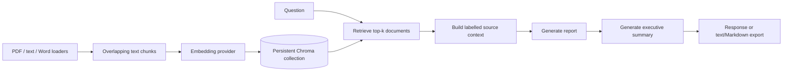

# Company reports from retrieved documents

A Python RAG application that turns a question and an indexed document collection into a report, an executive summary, and a source list. LangGraph makes the four processing stages explicit; Chroma stores document chunks; the CLI and FastAPI layer expose the same workflow.

This is a report-generation prototype. Retrieved context can improve an answer, but the application does not verify every generated claim or citation. It should not be presented as a production financial analyst or a source of audited company facts.

## The workflow



The graph is sequential, not a free-running multi-agent system. Retrieval records document scores; the context node labels each source; two model calls produce the report and summary. Tests can inject a model and vector-store backend to exercise this flow without a live provider.

The report prompt asks for factual, cited answers and acknowledgement of missing information. It is still a prompt, not a grounding validator. `MAX_REPORT_LENGTH` is a target in that prompt, not a hard output-token cap. Retrieved documents are untrusted input; prompt-injection defenses and formal answer evaluation are not implemented.

## A small, inspectable example

[`examples/company-brief.md`](examples/company-brief.md) contains invented revenue numbers, two products, and deliberate gaps. It is included so the first run does not depend on an untracked `data/raw_data` directory.

From this repository root, using Python 3.11 or later:

```sh
python -m venv .venv
source .venv/bin/activate
pip install -r requirements.txt
cp .env.example .env
# Configure your provider key and model choices locally.
python main.py --ingest-file examples/company-brief.md
python main.py --query "How did revenue change, and what cannot be concluded?" --output --format markdown
```

The input supports a 20% revenue increase and says nothing about profit. A useful manual check is whether the report explains that distinction and names the supplied document. No generated answer or benchmark score is fabricated here. Embedding and chat requests can incur provider charges, and document content is sent to that provider.

Use `python main.py --stats` to inspect the collection. Repeated ingestion can add duplicate content; it is not a documented incremental upsert pipeline. `python main.py --clear` clears the collection after its CLI confirmation; use a disposable development collection.

## API

```sh
python -m uvicorn src.api.main:app --host 127.0.0.1 --port 8000
```

Visit localhost:8000/docs for the actual request schemas. For example:

```http
POST /ingest/text
Content-Type: application/json

{"text":"Synthetic revenue: Q1 100 units, Q2 120 units.","source_name":"demo-brief"}
```

Then request a report:

```http
POST /query
Content-Type: application/json

{"query":"Compare the two quarters.","save_report":false,"format":"markdown"}
```

The response includes `query`, `report`, `summary`, `sources`, `num_tokens_used`, `total_cost_usd`, and optional `saved_file`. These are response fields, not promises of answer quality or exact billing. Other routes are `GET /health`, `GET /stats`, `GET /costs`, `POST /ingest/file`, and `DELETE /clear`.

The API has no authentication, authorization, upload-size limit, or tenant isolation. The destructive clear route is not separately protected. Keep it on loopback with synthetic documents; a shared service needs those controls and bounded/background model work first. Its async routes currently perform synchronous retrieval and model work.

## Design choices and practical limits

| Choice | Benefit | Tradeoff |
| --- | --- | --- |
| Four explicit graph nodes | Easy to inspect state and isolate stages | Errors are stored in state; not every edge short-circuits on failure |
| Persistent local Chroma | Simple development storage | No demonstrated multi-tenant or distributed deployment |
| Injectable model/store backends | Repeatable unit tests | Mock success does not establish provider compatibility or retrieval quality |
| Token and cost logging | Useful rough visibility per session | Token counts are locally estimated; bundled prices are historical and unknown models return zero |
| Source-name list in exports | Helps locate candidate evidence | No sentence-level citation validator or factuality guarantee |

Configuration is defined in [`src/config/settings.py`](src/config/settings.py), with examples in [`.env.example`](.env.example). The dependency list includes document and embedding packages beyond the small example's needs. Word loaders use `UnstructuredWordDocumentLoader`; `python-docx` alone does not guarantee that optional loader dependencies are available. Plain Markdown/text is the simplest initial input.

## Review and development

```sh
pytest
pytest --cov=src --cov-report=html
```

The existing tests cover graph nodes, injectable storage, ingestion, CLI/API wrappers, exports, and cost tracking. This presentation update was checked statically; the full dependency stack, tests, live embedding/chat calls, and containers were not rerun. No new quality, latency, cost, or production-readiness result is claimed.

For a shorter command sequence, use [QUICKSTART.md](QUICKSTART.md). `langgraph.json` and the scripts folder provide optional development entry points. Docker Compose defaults to a CLI help command rather than a long-running web API; choose an explicit command when using containers. The optional Jupyter profile now keeps token authentication and binds its published port to loopback.
